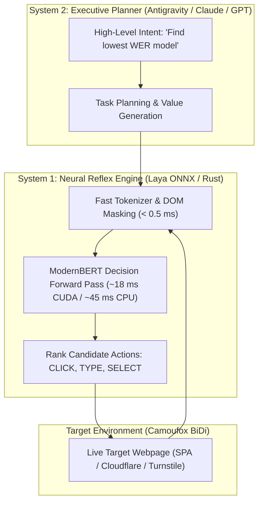

# The Pooki-Pra Architecture & Operator's Handbook
**High-Performance Anti-Detect Browser Agent System**  
*Document Version: 1.0.0 (Release Candidate)*  
*Target Operating Systems: Linux (Arch, Debian, Fedora), macOS, Windows*  
*Author: [Adhyansh Verma](https://huggingface.co/AdhyanshVerma)*

---

```
                       ___          _    _     ___             
                      / _ \___  ___| | _(_)___/ _ \_ __ __ _   
                     / /_)/ _ \/ _ \ |/ / /___/ /_)/ '__/ _` |  
                    / ___/ (_) \__ \   <| |  / ___/| | | (_| |  
                    \/    \___/|___/_|\_\_|  \/    |_|  \__,_|  
                    High-Performance Anti-Detect Browser Agent
```

---

## Table of Contents

1. [Executive Overview & Philosophy](#1-executive-overview--philosophy)
2. [Dual-System Neuro-Symbolic Architecture](#2-dual-system-neuro-symbolic-architecture)
3. [The Anti-Detect Subsystem & Camoufox Internals](#3-the-anti-detect-subsystem--camoufox-internals)
   * [3.1 Engine-Level C++ Patches](#31-engine-level-c-patches)
   * [3.2 The 2.1 GB Universal Font Catalog](#32-the-21-gb-universal-font-catalog)
   * [3.3 Hardware & Network Masking](#33-hardware--network-masking)
4. [Native Rust WebSocket BiDi Engine](#4-native-rust-websocket-bidi-engine)
   * [4.1 Marionette vs. BiDi Elimination of Middleware](#41-marionette-vs-bidi-elimination-of-middleware)
   * [4.2 Process Lifecycle & Sub-Second Execution](#42-process-lifecycle--sub-second-execution)
5. [Neural Decision Heads: FP32 vs Ultra-Edge INT8](#5-neural-decision-heads-fp32-vs-ultra-edge-int8)
   * [5.1 Laya ModernBERT Architecture](#51-laya-modernbert-architecture)
   * [5.2 Dynamic Tensor Axes & Action Space Tokenization](#52-dynamic-tensor-axes--action-space-tokenization)
   * [5.3 The 310 MB Ultra-Edge Quantization](#53-the-310-mb-ultra-edge-quantization)
6. [State Persistence & SQLite Engine](#6-state-persistence--sqlite-engine)
   * [6.1 Relational Schema & WAL Journaling](#61-relational-schema--wal-journaling)
   * [6.2 Persistent Profiles vs Ephemeral `--temp` Mode](#62-persistent-profiles-vs-ephemeral---temp-mode)
7. [Semantic In-Browser Markdown Extraction (`/scrape`)](#7-semantic-in-browser-markdown-extraction-scrape)
   * [7.1 Computed Visibility Heuristics](#71-computed-visibility-heuristics)
   * [7.2 Readability Filtration](#72-readability-filtration)
   * [7.3 GFM Normalization & Frontmatter](#73-gfm-normalization--frontmatter)
8. [Cross-Agent Interoperability Specification](#8-cross-agent-interoperability-specification)
   * [8.1 Model Context Protocol (MCP) Standard](#81-model-context-protocol-mcp-standard)
   * [8.2 Integration with Antigravity / Claude Code / Cursor / Windsurf](#82-integration-with-antigravity--claude-code--cursor--windsurf)
9. [Operator's Command Reference](#9-operators-command-reference)
10. [License & Intellectual Property](#10-license--intellectual-property)

---

## 1. Executive Overview & Philosophy

**Pooki-Pra** is an open-source, anti-detect browser automation framework purpose-built for autonomous AI agents. Unlike standard Selenium, Puppeteer, or Playwright implementations, which trigger immediate bot detection via standardized driver headers and leaked JavaScript globals, Pooki-Pra achieves **cryptographic and behavioral indistinguishability from human desktop browsers**.

### Core Tenets:
* **Zero Fingerprint Leaks**: `navigator.webdriver = false`, real graphics APIs, randomized WebGL noise, and unified font rendering.
* **Dual-System Latency Separation**: Reflex actions execute in $< 45\text{ ms}$ on local neural decision heads; executive planning is offloaded to large reasoning models.
* **Universal Agent Compatibility**: Full compliance with the Model Context Protocol (MCP) and Unix stdio pipelines.

---

## 2. Dual-System Neuro-Symbolic Architecture

Pooki-Pra bifurcates browser navigation into two cognitive layers:



1. **System 2 (The Executive Planner)**: Large Language Models (LLMs) break abstract user prompts into sub-goals. System 2 never reads megabytes of raw HTML; it receives semantic summaries.
2. **System 1 (The Neural Decision Head)**: Laya ModernBERT runs non-autoregressive forward inference directly over candidate interactive DOM markers (`[data-agent-id]`), picking the optimal target element without token latency.

---

## 3. The Anti-Detect Subsystem & Camoufox Internals

### 3.1 Engine-Level C++ Patches
Standard GeckoDriver or ChromeDriver inject automation flags at compile time:
* `navigator.webdriver`: Hardcoded to `true`.
* `window.cdc_adoQpoasnfa76pfcZLmcfl_Array`: Leaked ChromeDriver internal arrays.
* Marionette TCP interfaces exposed over standard debug sockets.

Camoufox replaces these components with C++ engine-level hooks in `libxul.so`:
* Dynamically sets `navigator.webdriver` to `false`.
* Suppresses WebRTC internal IP address leaks.
* Injects micro-jitter into `CanvasRenderingContext2D.getImageData()` to evade deterministic canvas fingerprinting.

### 3.2 The 2.1 GB Universal Font Catalog
Modern bot shields (Cloudflare Turnstile, DataDome, FingerprintJS) measure text bounding boxes across thousands of font glyphs to identify the host operating system. Linux distributions inherently leak their font configuration (lacking Microsoft Arial, Apple San Francisco, etc.).

Pooki-Pra's Camoufox binary bundles a complete **2.1 GB font collection** (`fontconfig/` and `fonts/`):
* Contains genuine cross-platform TrueType/OpenType typefaces.
* Font queries return identical metrics to an authentic Windows 11 / macOS desktop installation.

### 3.3 Hardware & Network Masking
Every session configures `CAMOU_CONFIG_1` environment flags:
* `navigator.hardwareConcurrency`: Bound to realistic desktop cores (`16` or `20`).
* `screen.width` / `screen.height`: Normalized desktop resolution (`1920x1080`).

---

## 4. Native Rust WebSocket BiDi Engine

### 4.1 Marionette vs. BiDi Elimination of Middleware
Prior architectures required:
$$\text{Rust / Python} \xrightarrow{\text{HTTP}} \text{geckodriver} \xrightarrow{\text{TCP}} \text{Marionette} \xrightarrow{} \text{Firefox}$$

Pooki-Pra utilizes **direct W3C WebDriver BiDi** over asynchronous WebSockets:
$$\text{pooki-pra (Rust)} \xleftrightarrow[\text{sub-ms}]{\text{WebSocket BiDi}} \text{Camoufox (Firefox)}$$

* Connects directly to `ws://127.0.0.1:<port>/session`.
* Zero intermediate daemon processes.
* Standardized JSON-RPC 2.0 payloads (`browsingContext.navigate`, `script.evaluate`, `browsingContext.captureScreenshot`).

### 4.2 Process Lifecycle & Sub-Second Execution
* **Ephemeral Port Allocation**: Dynamic OS loopback binding prevents port collisions.
* **RAII Cleanups**: In Rust, `CamoufoxProcess` implements `Drop`, issuing `child.start_kill()` on scope exit, ensuring no zombie browser instances remain in memory.
* **Cold-Start Speed**: Full process boot to finished navigation in under **1.8 seconds**.

---

## 5. Neural Decision Heads: FP32 vs Ultra-Edge INT8

### 5.1 Laya ModernBERT Architecture
* **Base Architecture**: ModernBERT (256,000 vocabulary, unpadded rotary embeddings).
* **Action Types**: `CLICK`, `TYPE_TEXT`, `SELECT`, `SCROLL_DOWN`, `SCROLL_UP`, `WAIT`, `DONE`.
* **Marker Positioning**: Candidate interactive elements in the DOM are tagged with `data-agent-id` and prepended with `[mask_token_id]` in the input sequence.

### 5.2 Dynamic Tensor Axes
The ONNX models are compiled with dynamic dimensions:
$$\text{input\_ids} \in \mathbb{R}^{\text{batch} \times \text{seq\_len}}, \quad \text{marker\_pos} \in \mathbb{R}^{\text{batch} \times \text{num\_markers}}$$

### 5.3 The 310 MB Ultra-Edge Quantization
Pooki-Pra ships with two neural weights:

1. **Full Precision (FP32)**: `model.onnx` + `model.onnx.data` (1.28 GB). Recommended for NVIDIA TensorRT / CUDA desktop inference.
2. **Ultra-Edge (INT8)**: `model_edge_int8.onnx` (**310.1 MB**). Symmetric per-channel dynamic quantization. Runs in $< 45\text{ ms}$ on standard x86_64 CPUs and ARM64 devices without GPU acceleration.

---

## 6. State Persistence & SQLite Engine

### 6.1 Relational Schema & WAL Journaling
Centralized state is maintained in `~/.local/share/pooki-pra/pooki_pra.db` under Write-Ahead Logging (`PRAGMA journal_mode = WAL`):

```sql
CREATE TABLE profiles (
    id INTEGER PRIMARY KEY AUTOINCREMENT,
    name TEXT UNIQUE NOT NULL,
    path TEXT NOT NULL,
    is_temp INTEGER DEFAULT 0,
    is_active INTEGER DEFAULT 0,
    created_at TEXT NOT NULL,
    last_used_at TEXT NOT NULL,
    notes TEXT DEFAULT ''
);

CREATE TABLE sessions (
    id INTEGER PRIMARY KEY AUTOINCREMENT,
    session_uuid TEXT UNIQUE NOT NULL,
    profile_name TEXT NOT NULL,
    started_at TEXT NOT NULL,
    ended_at TEXT,
    initial_url TEXT,
    status TEXT DEFAULT 'active'
);

CREATE TABLE scrapes (
    id INTEGER PRIMARY KEY AUTOINCREMENT,
    url TEXT NOT NULL,
    title TEXT NOT NULL,
    file_path TEXT NOT NULL,
    word_count INTEGER,
    profile_name TEXT,
    scraped_at TEXT NOT NULL
);
```

### 6.2 Persistent Profiles vs Ephemeral `--temp` Mode
* **Persistent Profiles**: Saved to `~/.local/share/pooki-pra/profiles/<name>/`. Retains `cookies.sqlite` and `storage/default/` (IndexedDB / LocalStorage) to keep user accounts authenticated across agent workflows.
* **Ephemeral Mode (`--temp`)**: Spawns isolated directories under `/tmp/pooki_pra_temp_<uuid>/`. Automatically swept and recursively unlinked upon session termination.

---

## 7. Semantic In-Browser Markdown Extraction (`/scrape`)

### 7.1 Computed Visibility Heuristics
Static scrapers extract hidden honeypot text. Pooki-Pra checks live computed layouts inside the browser DOM:
$$\text{visible}(e) \iff (\text{display} \neq \text{'none'}) \land (\text{visibility} \neq \text{'hidden'}) \land (\text{opacity} > 0) \land (\text{rect.width} > 0)$$

### 7.2 Readability Filtration
Automatically purges non-article boilerplate:
* `<nav>`, `<footer>`, `<aside>`, `[role="dialog"]`, `.cookie-banner`, `.advertisement`.
* Isolates primary `<article>` or `<main>` content containers.

### 7.3 GFM Normalization & Frontmatter
Outputs clean GitHub Flavored Markdown:
* HTML `<table>` elements converted to GFM pipe tables (`| col1 | col2 |`).
* Code blocks extracted with language hints (` ```rust ... ``` `).
* Standardized YAML frontmatter (`title`, `url`, `scraped_at`, `word_count`, `reading_time_min`).

---

## 8. Cross-Agent Interoperability Specification

### 8.1 Model Context Protocol (MCP) Standard
Pooki-Pra exposes a standard Model Context Protocol server over `stdio` via JSON-RPC 2.0.

#### Tool Declarations:
1. `browser_navigate(url, profile_name, is_temp)`: Navigates to a URL.
2. `browser_step(goal, fill_text)`: Runs Laya reflex inference to advance navigation.
3. `browser_scrape(url, mode, output_path)`: Converts web page to Markdown.
4. `browser_screenshot(filename)`: Captures PNG viewport.
5. `browser_close()`: Shuts down browser context.
6. `profile_create(name, copy_from)`: Allocates persistent profile.
7. `profile_list()`: Inspects profile storage and disk usage.
8. `profile_switch(name)`: Sets active identity.
9. `profile_delete(name, force)`: Removes profile directory.
10. `session_history(limit)`: Queries SQLite audit logs.

### 8.2 Client Configuration Examples

#### Antigravity CLI (`~/.gemini/config/mcp_config.json`):
```json
{
  "mcpServers": {
    "pooki-pra": {
      "command": "pooki-pra",
      "args": ["mcp"]
    }
  }
}
```

#### Claude Code:
```bash
claude mcp add pooki-pra -- pooki-pra mcp
```

#### Cursor / Windsurf (`mcp.json`):
```json
{
  "mcpServers": {
    "pooki-pra": {
      "command": "pooki-pra",
      "args": ["mcp"]
    }
  }
}
```

---

## 9. Operator's Command Reference

```bash
# Navigate to a URL
pooki-pra navigate https://crates.io/crates/tokio

# Scrape page to clean Markdown with frontmatter
pooki-pra scrape https://crates.io/crates/tokio --output ./tokio.md

# Capture viewport screenshot
pooki-pra screenshot https://crates.io/crates/tokio ./tokio.png

# Launch Model Context Protocol daemon
pooki-pra mcp
```

---

## 10. License & Intellectual Property

```
The MIT License (MIT)
Copyright (c) 2026 Adhyansh Verma

Permission is hereby granted, free of charge, to any person obtaining a copy
of this software and associated documentation files (the "Software"), to deal
in the Software without restriction, including without limitation the rights
to use, copy, modify, merge, publish, distribute, sublicense, and/or sell
copies of the Software, and to permit persons to whom the Software is
furnished to do so, subject to the following conditions:

The above copyright notice and this permission notice shall be included in all
copies or substantial portions of the Software.

THE SOFTWARE IS PROVIDED "AS IS", WITHOUT WARRANTY OF ANY KIND, EXPRESS OR
IMPLIED, INCLUDING BUT NOT LIMITED TO THE WARRANTIES OF MERCHANTABILITY,
FITNESS FOR A PARTICULAR PURPOSE AND NONINFRINGEMENT. IN NO EVENT SHALL THE
AUTHORS OR COPYRIGHT HOLDERS BE LIABLE FOR ANY CLAIM, DAMAGES OR OTHER
LIABILITY, WHETHER IN AN ACTION OF CONTRACT, TORT OR OTHERWISE, ARISING FROM,
OUT OF OR IN CONNECTION WITH THE SOFTWARE OR THE USE OR OTHER DEALINGS IN THE
SOFTWARE.
```
